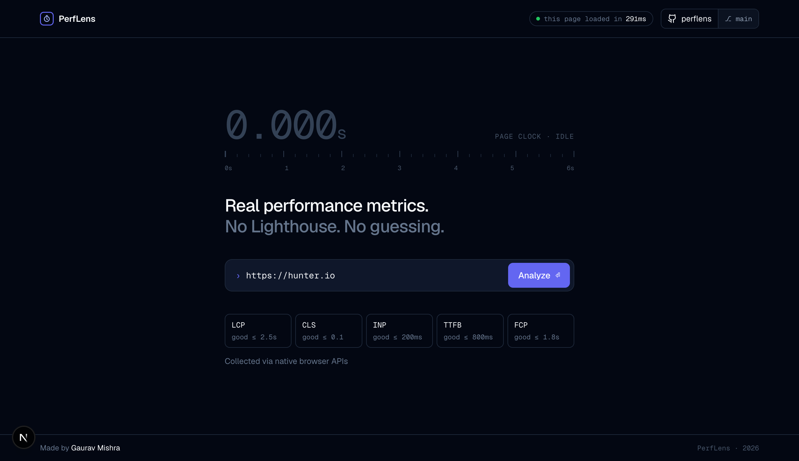
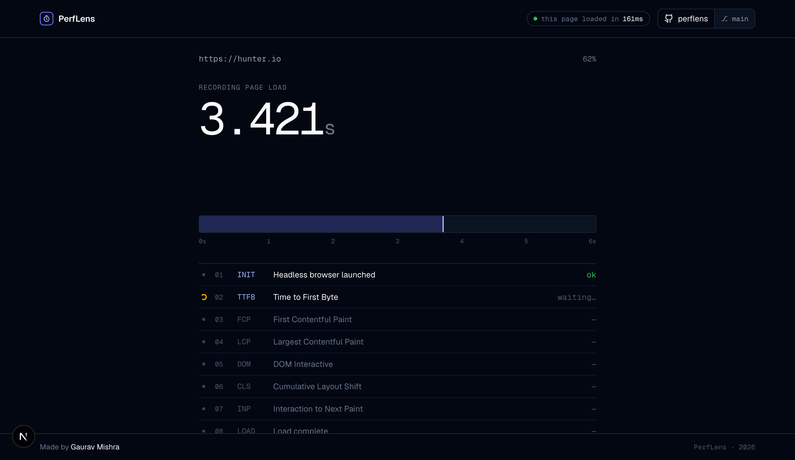
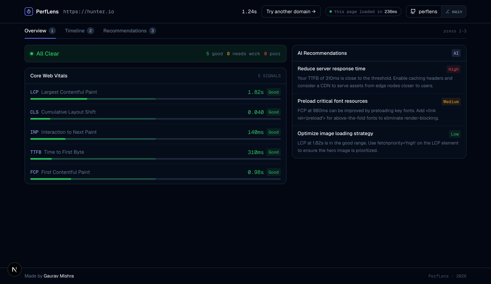
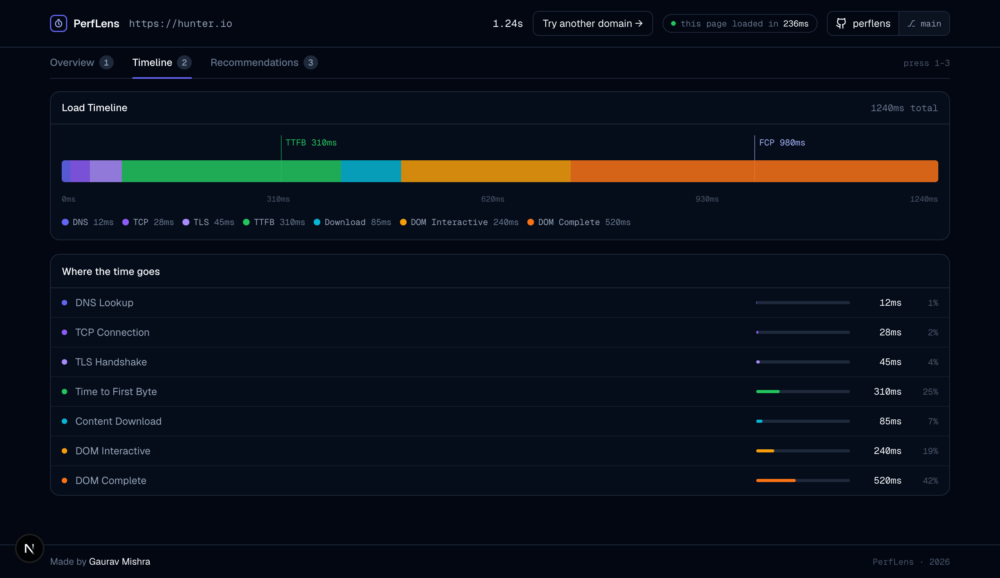
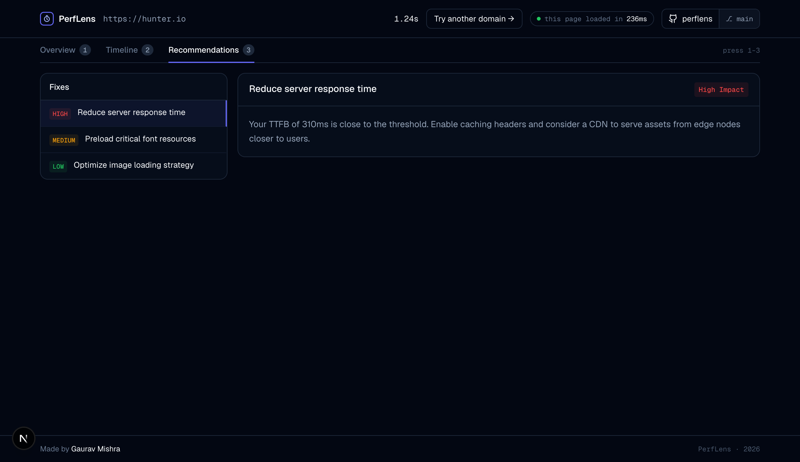

<div align="center">



<br/>
<br/>

<h1>PerfLens</h1>

<p><strong>Real performance metrics. No Lighthouse. No guessing.</strong></p>

<p>
  Drop in a URL → a headless browser loads it → you get real Core Web Vitals in seconds,<br/>
  plus AI-powered fixes ranked by impact.
</p>

<p>
  
  
  
  
  
</p>

</div>

---

## Why PerfLens?

Lighthouse runs in a throttled lab environment and returns synthetic scores. PerfLens fires up a real headless Chromium instance, loads your URL exactly as a browser would, and reads the native Performance APIs — the same numbers your users actually experience.

|  | Lighthouse | PerfLens |
|---|---|---|
| LCP source | Simulated | Native `PerformanceObserver` |
| CLS source | Simulated | Layout shift entries |
| INP source | Estimated | Real interaction events |
| Environment | Throttled lab | Real Chromium, real network |
| AI recommendations | ✗ | ✓ Gemini-powered |

---

## Screenshots

### Live Scan in Progress



### Overview — Core Web Vitals + AI Recommendations



### Timeline — Full Request Waterfall



### Recommendations — AI-ranked Fixes



---

## Features

- **Real metrics** — LCP, CLS, INP, FCP, TTFB collected via native browser APIs inside a real Chromium process, not a simulation
- **Full request waterfall** — DNS → TCP → TLS → TTFB → Download → DOM Interactive → DOM Complete, all in one view
- **AI recommendations** — Google Gemini analyses your exact numbers and returns 3 actionable fixes, ranked High / Medium / Low
- **Live lap counter** — watch each metric land in real time as the headless browser records the page load
- **Keyboard shortcuts** — press `1` `2` `3` to switch tabs without touching the mouse
- **Serverless-ready** — uses `@sparticuz/chromium` in production so it deploys to Vercel with zero extra config

---

## How it works

```
User submits URL
       │
       ▼
 POST /api/run
  └─ Puppeteer launches headless Chromium
  └─ Injects PerformanceObserver before page scripts run
  └─ Navigates to URL, waits for full load
  └─ Reads window.__perfMetrics
  └─ Returns { lcp, cls, inp, fcp, ttfb, waterfall }
       │
       ▼
 POST /api/analyze  (metrics → Gemini flash-lite)
  └─ Returns 3 prioritised fix recommendations as JSON
       │
       ▼
 Dashboard — Overview / Timeline / Recommendations
```

---

## Getting Started

### 1. Clone & install

```bash
git clone git@github-personal:langmop/perflens-next.git
cd perflens-next
npm install
```

### 2. Set environment variables

Create a `.env.local` file:

```bash
GEMINI_API_KEY=your_key_here
```

Get a free key at [aistudio.google.com](https://aistudio.google.com/app/apikey). Without it the scan still works — the Recommendations tab shows a fallback notice.

### 3. Run

```bash
npm run dev
# → http://localhost:3000
```

> **Note:** Local dev uses the full `puppeteer` package (bundled Chromium, ~170 MB). Production uses `@sparticuz/chromium` + `puppeteer-core` for a serverless-compatible binary — no extra setup needed.

---

## Deploy to Vercel

```bash
vercel deploy
```

Add `GEMINI_API_KEY` under **Project → Settings → Environment Variables**.

The `/api/run` route sets `maxDuration = 60` to give Puppeteer enough time on slower pages.

---

## Tech Stack

| Layer | Choice |
|---|---|
| Framework | Next.js 16 (App Router) |
| UI | React 19 + Tailwind CSS 4 |
| Browser automation | Puppeteer 25 / `@sparticuz/chromium` |
| AI | Google Gemini `gemini-flash-lite-latest` |
| Testing | Jest 30 + Testing Library |
| Fonts | Geist (Vercel) |

---

## Tests

```bash
npm test          # run once
npm run test:watch  # watch mode
```

---

## License

MIT © [Gaurav Mishra](https://github.com/langmop)
